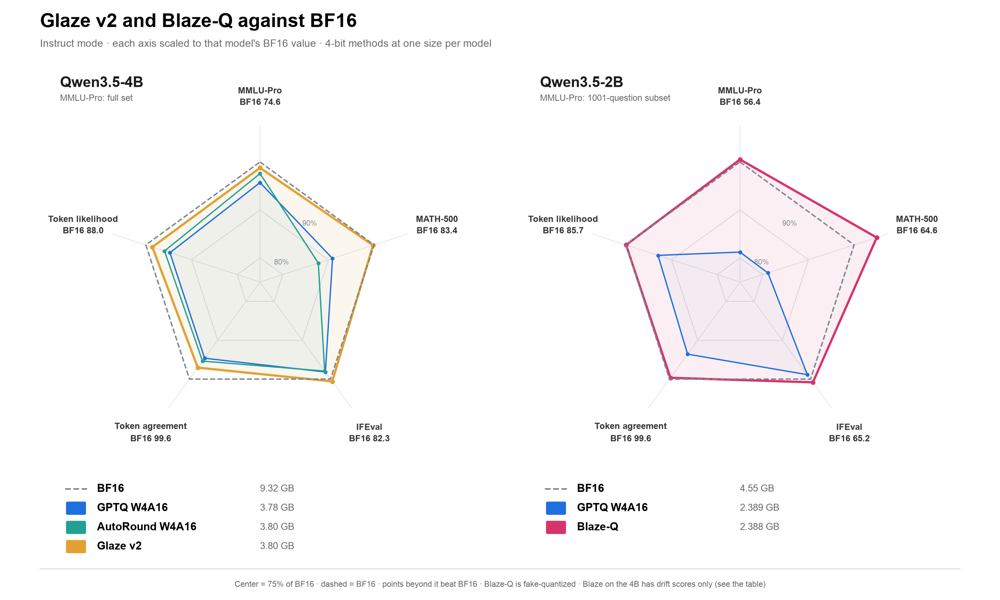

# 8. Blaze: moving the vocabulary's bytes into the body

At equal file size, a 4-bit Qwen3.5 export spends a third of its bytes on a BF16 vocabulary table:
the 4B's tied embedding and LM head is 1.27 GB of its 3.78 GB. Blaze stores the busiest rows at
8 bits and the rest at 4 (the ladder), then spends the freed bytes on the transformer body,
choosing each unit's precision by measured KL. Nothing is trained or Fisher-weighted, and no
in-domain answers are needed.

**Status:** every gate has run (G0-G5). On the 4B at a standard W4A16 export's size, with the
vision tower at 8 bits as Glaze v2 stores it, Blaze-Q's excess loss is 0.0017, 8.5x below Glaze
v2's, and on the full suite it is within a point of BF16 on 12 of 13 tasks; MathVista is 1.1
below (paired interval −2.6 to +0.5). On the 2B it matches BF16 where W4A16 loses 10-12 points,
and its real format reproduces the fake-quantized scores exactly. The 4B's numbers are
fake-quantized: its 6-bit body needs a kernel vLLM does not have.

## Why bytes rather than rounding

- **Per-layer rounding is near its limit.** WaterSIC is proven within 0.25 bit per weight of the
  information-theoretic limit, and plain GPTQ with a random rotation lands within 0.1 bit of it on
  Llama-3-8B ([Lifar et al., ICML 2026](https://icml.cc/virtual/2026/poster/62598);
  [arXiv 2601.17187](https://arxiv.org/abs/2601.17187v1)).
- **Here, excess loss falls about 4× per added bit.** AutoRound's 0.042 at 4.12 bits per body
  weight predicts 0.016 at Glaze v2's 4.83 bits; Glaze v2 measured 0.014
  ([drift study](03-drift-study.md), [Glaze v2](06-glaze-v2.md)).
- **The vocabulary is the largest pool of bytes.** In a standard W4A16 export (4-bit body, BF16
  vocabulary and vision tower), its tables are 53% of the 0.8B, 43% of the 2B, 34% of the 4B, 48%
  of the 9B (two tables, untied) and 27% of the 27B.

## Method

1. **Usage census** (CPU, once per tokenizer): how often each of the 248,320 rows is used.
2. **Vocabulary ladder:** rows renumbered by use; the busiest rows, at least 65,536 and enough to
   cover 99.9% of the census, at 8-bit g128; the rest at 4-bit g128. Tied tables are laddered
   once; untied models ladder the LM head and keep the input table at 4 bits.
3. **Body menu:** each fused unit takes 4-bit g128, g64 or g32, or 8-bit g128 (Marlin), and a
   6-bit option if a kernel for it is built.
4. **Measured byte market:** each unit's price is the KL to BF16 it adds alone, on generic text;
   an exact knapsack (Glaze v2's solver) buys options within the file size.
5. **Export:** compressed-tensors for the body and a tiered vocabulary module for vLLM.

## G0: usage census

`scripts/blaze_census.py` counts the tokens of training splits only (MATH, GSM8K, ARC-Challenge,
SciQ, HellaSwag, WikiText-2, 20,000 UltraChat conversations and 20,000 COCO captions) and of BF16's
answers to Glaze v2's training prompts. No test split and no benchmark answer is counted. The
counts and their sources are locked in `data/blaze/census.lock.json`.

| Result | Value |
| --- | --- |
| Rows used at least once | 80,010 of 248,320 (168,310 never) |
| BF16 answer tokens in the busiest 16,384 / 32,768 / 65,536 rows | 96.48% / 99.08% / 99.97% |
| Ladder | 65,536 rows at 8-bit g128, 182,784 at 4-bit g128 |

The last two coverage figures are in-sample: the answers they score are part of the census. G1
measures the ladder on BF16's MATH-500 and MMLU-Pro answers, which the census never saw.

### Held-out coverage, and the census's blind spot

Scored on text no census saw (`scripts/blaze_domain_coverage.py`), the share of tokens whose row
is in the 8-bit rung. The research page's early 57M-token count included the benchmarks' test
questions and BF16's answers to them; it was exploratory, the ladder was never built from it, and
the page now quotes this census instead (corrected 2026-10-17).

| Held-out text | Tokens | English census (as built) | + FineWeb-2, 30 languages |
| --- | ---: | ---: | ---: |
| BF16's answers on the record's benchmarks | 19.1M | 99.88% | 98.81% |
| Code: HumanEval, MBPP, MultiPL-E (JS, C++, Java, Go, Rust) | 212k | 96.5% | 91.2% |
| Non-English: MGSM (10 languages), Belebele (8 more) | 1.02M | 26.5% | 93.2% |
| … MGSM Chinese / Japanese / Russian | 50k | 35.5% / 28.0% / 28.5% | 64.4% / 74.9% / 76.0% |
| … MGSM Thai / Bengali / Telugu | 126k | 14.8% / 17.1% / 8.2% | 95.5% / 100% / 99.0% |
| … Belebele Arabic / Korean / Tamil | 318k | 26.3% / 16.4% / 4.8% | 80.3% / 75.9% / 99.9% |

The English census leaves most non-English tokens on 4-bit rows; MBPP (89.8%) is its weakest code
source, and the multilingual census costs code most in Rust (98.7% to 87.3%).
`scripts/blaze_census_multilingual.py` adds the first 300,000 tokens of FineWeb-2's training text in
each of 30 languages (`data/blaze/census_multilingual.json`). At the default 99.9% cover that census
would want 152,794 8-bit rows (about 112 MB more); planned at the same 65,536 rows (`--cover 1e-9`),
the table's bytes are unchanged and only the choice of rows moves. Whether the lost English and code
coverage costs anything is for drift to say; `scripts/run_blaze_q6.py` measures it.

| Model | Vocabulary in BF16 | Laddered, index map included |
| --- | ---: | ---: |
| Qwen3.5-0.8B | 0.509 GB | 0.166 GB |
| Qwen3.5-2B | 1.017 GB | 0.330 GB |
| Qwen3.5-4B | 1.271 GB | 0.413 GB |
| Qwen3.5-9B (untied) | 4.068 GB | 1.184 GB |
| Qwen3.5-27B (untied) | 5.086 GB | 1.480 GB |

## G1 design

G1 answers two questions before anything else is built: is the ladder free, and does the body
need a 6-bit kernel? Its exports are fake-quantized: the BF16 checkpoint with the chosen tensors
replaced by the values the real format stores, so stock vLLM scores them like the BF16 model.

| Variant or measure | What changes | Pass if |
| --- | --- | --- |
| `blaze_ladder` | The ladder; body in BF16 | Flip rate ≤ 0.6% and excess loss ≤ 0.001 |
| `blaze_ladder_w6` | The ladder, every body Linear at 6-bit g128 round-to-nearest | Excess loss ≤ 0.004 |
| `blaze_ladder_w4` | The ladder, the body at 4-bit g128 round-to-nearest | Reference: the 4×-per-bit rule predicts 16× more excess loss than at 6 bits |
| FFN prices | Each of the 32 FFN layers alone at 4-bit g128; KL to BF16 on 32 blocks of 2,048 WikiText-2 training tokens | The most expensive half of the FFN weights holds ≥ 75% of the summed price |

Drift is scored as in the [drift study](03-drift-study.md), on BF16's 1,501 MATH-500 and
MMLU-Pro answers. The decision (`blaze.gates.decide`):

| Ladder free | 6-bit pays | 4/8-bit menu enough | Next |
| --- | --- | --- | --- |
| No | any | any | Retest once with 131,072 hot rows; drop the ladder if it still fails |
| Yes | Yes | Yes | G2 on the 4/8-bit menu; a 6-bit kernel would add more |
| Yes | Yes | No | G2 needs the 6-bit option: start the kernel |
| Yes | No | Yes | G2 on the 4/8-bit menu; no 6-bit kernel |
| Yes | No | No | Stop on the 4B; check the 2B before more |

Two choices differ from the first draft of the plan. The 6-bit variant uses round-to-nearest
instead of GPTQ, so it needs no calibration data; GPTQ would do better, and the threshold is 0.004
rather than 0.003 to allow for that. The FFN prices use KL on generic text rather than drift
replays, because 32 separate vLLM loads would take hours.

| | |
| --- | --- |
| Code | `src/qwen35_compression/blaze/`, `scripts/blaze_census.py`, `scripts/blaze_export.py`, `scripts/blaze_sensitivity.py`, `scripts/run_blaze_g1.py` |
| Hardware | One NVIDIA A30 (24 GB); three BF16-size exports need about 28 GB of disk |
| Estimate | About 1.75 hours with the pilot: ₹68 (about $0.71) at ₹38.88 per hour and ₹96.3 per dollar |

## G1 results

Run `r_d95d713c` on one A30, code `a16401f`, 16 October 2026: about 52 minutes with the pilot,
₹33.48 (about $0.35). Drift on BF16's 1,501 answers (2,304,479 tokens); BF16 flips 0.35% of its
own tokens on replay.

| Variant or measure | Flip rate | Excess loss | Mark | Result |
| --- | ---: | ---: | --- | --- |
| `blaze_ladder` | 0.40% | 0.00022 | ≤ 0.6% and ≤ 0.001 | Passes: the ladder is free |
| `blaze_ladder_w6` (round-to-nearest) | 1.79% | 0.00483 | ≤ 0.004 | Misses narrowly |
| `blaze_ladder_w4` (round-to-nearest) | 7.54% | 0.0943 | reference | 19.5× the 6-bit excess; the rule predicts 16× |
| FFN prices | | | concentration ≥ 0.75 | 0.648: misses |

The FFN layers price alike (KL 0.0017-0.0027 each at 4 bits), except layer 31 at 0.0062, so moving
a few layers to 8 bits buys little: the 4B's body needs a 6-bit option. The decision rule read
"stop on the 4B; check the 2B before more", and both checks below were run.

## G1b: a GPTQ-rounded 6-bit body

`blaze_ladder_gptq6` is G1's 6-bit variant with the body rounded by GPTQ instead of to nearest:
the same symmetric g128 grid (`blaze/gptq.py`; BF16 scales, codes times scale in BF16), columns
rounded left to right with their error spread through the inverse Hessian's Cholesky factor,
layers in order on the quantized chain. Calibration is 128 blocks of 2,048 tokens of WikiText-2's
training split, the prices' pinned file: generic text, not the model's own answers. It is held to
the first draft's GPTQ mark, 0.003.

Run `r_34e094ca` on one A30, code `672e9ca`: about 38 minutes with the pilot (GPTQ 10 minutes,
peak 11.4 GB), about ₹25 (about $0.26).

| Variant | Flip rate | Excess loss | Mark | Result |
| --- | ---: | ---: | --- | --- |
| `blaze_ladder_w6`, round-to-nearest (G1) | 1.79% | 0.00483 | | |
| `blaze_ladder_gptq6` | 1.76% | **0.00269** | ≤ 0.003 | Passes |

GPTQ lowers the excess loss 1.8× at the same bits, and to 19% of Glaze v2's 0.0143, with no
in-domain data. The 6-bit option pays, so G2 needs a 6-bit kernel. A fully 6-bit body is a
little over the 4B's equal-size budget (the laddered table frees enough for about 6.0 bits per
body weight with scales), so an equal-size Blaze-Q on the 4B is mostly 6-bit with some units at 4.

## G5: Qwen3.5-2B at W4A16's size

On the 2B the ladder frees as many bytes as an all-8-bit body costs, so Blaze-Q is the ladder
plus every body Linear at 8-bit g128, rounded to nearest with no calibration data. The baseline
is Feature 1's GPTQ W4A16 g128 recipe unchanged (512 UltraChat samples of 2,048 tokens). Both are
scored against BF16 (revision `15852e8`): drift on BF16's own MATH-500 and MMLU-Pro answers, and
the reasoning panel's text tasks with the instruct track's settings (MMMU, the panel's vision
task, was not run). Sizes are counted as the real formats store them, the MTP head excluded on
both sides.

Run `r_bf0526dd` on one A30, code `672e9ca`: about 100 minutes with the pilot (GPTQ 12 minutes;
each panel 14-20 minutes), about ₹67 (about $0.70).

| | BF16 | GPTQ W4A16 g128 | Blaze-Q |
| --- | ---: | ---: | ---: |
| Vocabulary table | 1.017 GB | 1.017 GB | 0.330 GB |
| Body Linears | 2.745 GB | 0.708 GB | 1.394 GB |
| Total (with the BF16 vision tower and norms) | 4.43 GB | 2.3889 GB | 2.3884 GB |
| Flip rate (BF16's 1,501 answers, 3,149,312 tokens) | 0.38% | 6.78% | 0.71% |
| Excess loss | | 0.0730 | **0.00046** |
| MATH-500 | 64.6 | 52.4 | 67.8 |
| MMLU-Pro (1001-question subset) | 56.4 | 45.9 | 56.7 |
| IFEval (prompt, strict) | 65.3 | 64.5 | 65.8 |

Paired changes from BF16, with bootstrap 95% intervals:

| Task | GPTQ W4A16 | Blaze-Q |
| --- | --- | --- |
| MATH-500 | -12.2 (-16.8 to -7.6) | +3.2 (-1.0 to +7.4) |
| MMLU-Pro | -10.6 (-13.8 to -7.6) | +0.3 (-2.2 to +2.7) |
| IFEval | -0.7 (-4.4 to +3.0) | +0.6 (-2.4 to +3.7) |

All three checks pass: Blaze-Q's excess loss is 0.6% of W4A16's (the mark was a third), it is
432 KB smaller, and no panel task is more than a point below BF16 (none of its changes is
distinguishable from zero). Blaze is not a 4B-only result. The 2B is the easy case: there the
vocabulary's bytes buy a whole 8-bit body, which is close to lossless, against a 4-bit baseline
that loses more on a small model than on the 4B.

## G2: the 4B at W4A16's size

An all-6-bit body with the ladder is 34 MB over a standard W4A16 export of the 4B (3,814,198,272
bytes against 3,780,662,272, as the real formats store them). G2 lets the byte market step the
cheapest units down to 4 bits (`blaze/market.py`): each layer's token mixer and FFN (64 units, never
splitting a projection vLLM fuses) is priced alone at 4 and at 6 bits, round-to-nearest, as KL to
BF16 on 16 blocks of WikiText-2 training text; an exact min-cost cover picks the units to step
down; the body is then GPTQ-rounded at each Linear's option, as in G1b. It is held to 2.4x below
Glaze v2's excess loss (0.0060) at no more than W4A16's size.

Run `r_1d1c68f2` on one A30, code `c50e02c`: about 50 minutes with the pilot, about ₹32 (about
$0.33).

| Variant | Size (as stored) | Flip rate | Excess loss | Result |
| --- | ---: | ---: | ---: | --- |
| All-6-bit GPTQ body (G1b) | 3,814,198,272 B | 1.76% | 0.0027 | 0.4% over W4A16's size |
| G2 market: FFNs of layers 13 and 16 at 4 bits | 3,778,808,832 B | 2.32% | **0.0071** | Misses 0.0060 |
| Glaze v2 | 3,795,765,945 B | 3.29% | 0.0143 | |

Stepping two FFN layers down to 4 bits more than doubled the excess loss, where the prices
predicted a fifth of that. The 6-bit prices look to be mostly measurement noise: they sum to 0.048
against 0.197 at 4 bits, a factor of 4 where the error model expects 16, so the market could not
tell the cheap units from the expensive ones at 6 bits. The decision rule stops here: G3 (the
panel) was not run. Two ways forward, neither tried: store the vision tower at 8 bits, as Glaze
v2 does, which frees about 333 MB and lets an all-6-bit body fit; or price units on more text, or
with GPTQ-rounded weights, before the market uses them.

## G2b and G3: the 4B with an 8-bit vision tower

G2 kept the vision tower in BF16, as a standard W4A16 export does. Glaze v2 stores it at 8-bit
g128; doing the same frees 324 MB, enough for the whole body at 6 bits with room left. G2b fills
that room upward (`blaze_market.py --mode fill`): units move from 6 to 8 bits by their measured
4-bit prices from G2, scaled to 6 and 8 bits by G1's measured bits rule (19.5x per two bits),
because G2's prices measured directly at 6 bits sat in the measurement's noise. The body is then
GPTQ-rounded at each Linear's option, as in G1b. Nothing measured before was run again: G2's
prices and BF16 drift score, and BF16's and Glaze v2's published panel answers, were reused.

Run `r_512d8da6` on one A30, code `ff33c11`: about 108 minutes with the pilot, the panel, MMMU
and the single-copy check below; ₹72.98 (about $0.76).

The market raised 23 of 64 units to 8 bits: the token mixers and FFNs of layers 0-6, the mixers of
layers 7, 8, 10, 11, 15, 19, 27 and 31, and layer 31's FFN, the outlier G1 found.

| | Size (as stored) | Flip rate | Excess loss |
| --- | ---: | ---: | ---: |
| Standard W4A16 g128 (the bound) | 3,780,662,272 B | | |
| G2 (vision BF16, two FFNs at 4 bits) | 3,778,808,832 B | 2.32% | 0.0071 |
| **G2b** (vision 8-bit, body 6/8-bit) | 3,780,086,784 B | **1.39%** | **0.0017** |
| Glaze v2 | 3,795,765,945 B | 3.29% | 0.0143 |

G2b passes G2's mark (at most 0.0060, no larger than W4A16): 8.5x below Glaze v2's excess loss, at
W4A16's size, with no in-domain data.

G3, the panel, on the instruct track's settings, against BF16's and Glaze v2's published answers
to the same questions (paired bootstrap, 2,000 resamples):

| Task | BF16 | Glaze v2 | Blaze-Q | Blaze-Q − BF16 | Blaze-Q − Glaze v2 |
| --- | ---: | ---: | ---: | --- | --- |
| MMLU-Pro (1001-question subset) | 73.6 | 71.1 | **73.6** | 0.0 (−1.9 to +1.9) | **+2.5 (+0.3 to +4.7)** |
| MATH-500 | 83.4 | 83.2 | 83.0 | −0.4 (−3.2 to +2.4) | −0.2 (−3.6 to +3.0) |
| IFEval (prompt, strict) | 82.3 | 82.8 | 82.4 | +0.2 (−2.4 to +2.6) | −0.4 (−3.3 to +2.2) |
| MMMU (val) | 69.6 | 66.7 | 68.7 | −0.9 | +2.0 |

No task is more than a point below BF16, so G3 passes; the decision rule's next step is G4, the
full suite. Blaze-Q is ahead of Glaze v2 on MMLU-Pro with an interval clear of zero, and level on
MATH-500 without Glaze v2's in-domain calibration data. MMMU is scored after download by the fixed
gpt-4o-mini extractor (`score_vision.py`); one of its 900 validation answers could not be
extracted and was filled at random by VLMEvalKit (BF16's run had 4, Glaze v2's 6). Its paired
interval is not computed.

## G4: the 4B's full suite

G4 scored the suite's remaining tasks on G2b's export, rebuilt on the GPU from G2b's saved plan;
its drift matched G2b's to the last digit (excess loss 0.0016895), so G3's MATH-500, IFEval and
MMMU complete the suite. MMBench and MathVista were scored after download by the fixed
gpt-4o-mini extractor, with no extraction failures. BF16's, AutoRound's and Glaze v2's columns are
their recorded full-suite results (records 4 and 6).

Run `r_f7c16f6c` on one A30, code `a76a268`: 4 hours 53 minutes (text 3.0 h, vision 1.2 h),
₹196.87 (about $2.04).

| Task | BF16 | AutoRound | Glaze v2 | Blaze-Q | Blaze-Q − BF16 |
| --- | ---: | ---: | ---: | ---: | ---: |
| MMLU-Pro | 74.6 | 72.8 | 73.7 | **75.2** | +0.6 |
| GSM8K | 83.2 | 82.3 | 82.8 | **83.3** | +0.1 |
| MATH-500 | 83.4 | 73.2 | 83.2 | 83.0 | −0.4 |
| IFEval | 82.3 | 80.6 | 82.8 | 82.4 | +0.1 |
| HellaSwag | 65.4 | 64.8 | 64.8 | **65.3** | −0.1 |
| ARC-Challenge | 51.1 | 50.0 | 49.6 | **51.0** | −0.1 |
| WikiText-2 (perplexity, lower is better) | 10.95 | 11.45 | 11.30 | **10.96** | +0.01 |
| MMBench (dev, EN v1.1) | 85.4 | 84.7 | 85.7 | 84.9 | −0.5 |
| MMMU (val) | 69.6 | 66.9 | 66.7 | **68.7** | −0.9 |
| MathVista (mini) | 81.0 | 80.3 | 80.6 | 79.9 | −1.1 |
| OCRBench | 86.3 | 87.2 | 86.3 | 86.5 | +0.2 |
| DocVQA (val) | 95.3 | 95.3 | 95.4 | **95.5** | +0.2 |
| TextVQA (val) | 82.8 | 82.5 | 82.2 | **82.9** | +0.1 |
| Checkpoint | 9.32 GB | 3.80 GB | 3.80 GB | 3.78 GB | |

- **Twelve of thirteen tasks are within a point of BF16**, and Blaze-Q is level with or ahead of
  Glaze v2 on ten. It recovers what Glaze v2 lost on ARC-Challenge (−1.5) and MMMU (−2.9), and
  WikiText-2's perplexity is BF16's to two decimals.
- **MathVista misses the mark by 0.1 point.** On its 1,000 questions, paired against BF16's own
  answers, the change is −1.1 (−2.6 to +0.5); Glaze v2's is −0.4 (−2.2 to +1.5) and Blaze-Q's
  against Glaze v2 is −0.7 (−2.7 to +1.1). The drop cannot be told apart from zero, but by the
  gate's rule G4 does not pass, and the drop is reported as measured.
- **Equal size, not equal bits.** Every 4-bit column spends a third of its file on a BF16
  vocabulary table; Blaze-Q spends those bytes on a 6/8-bit body. Averaged over every weight, all
  four quantized checkpoints sit near 6.7 bits.

## The ladder as an add-on, and Blaze-Q on 4/8-bit kernels

The ladder needs nothing else from Blaze. `blaze.addon` rewrites only an existing
compressed-tensors export's BF16 vocabulary table into the tiered form and copies every other
tensor and quantization group as it is. Applied to the published GPTQ, AutoRound and Glaze v2
exports of the 4B, it isolates exactly what the ladder costs and saves. The same run built a
Blaze-Q that serves on today's kernels: the GPTQ export, laddered, with the units the market
picks (by G2's measured 4-bit prices) re-quantized to 8-bit g128 from BF16, at W4A16's size.

Run `r_e5d73d36` on one A30, code `e63c8b0`: 90 minutes with the pilot, ₹60.93 (about $0.63).

| Qwen3.5-4B | Before | With the ladder | Excess loss before | After | Flip rate after |
| --- | ---: | ---: | ---: | ---: | ---: |
| GPTQ W4A16 g128 | 3.78 GB | **2.92 GB** | 0.0541 | 0.0542 | 5.70% |
| AutoRound W4A16 g128 | 3.78 GB | **2.92 GB** | 0.0417 | 0.0417 | 4.96% |
| Glaze v2 | 3.77 GB | **2.91 GB** | 0.0143 | 0.0144 | 3.30% |

- **The ladder is free on every export.** Each loses 0.86 GB (23%) and its excess loss moves by
  at most 0.0001. Glaze v2's quality at 2.91 GB, and any 4-bit Qwen3.5 checkpoint 23% smaller,
  serve today on vLLM with the `blaze-vllm` plugin.
- **It is faster for a single stream.** GPTQ with the ladder decodes 175 tokens per second against
  151 without it (+16%); batched it is 2,912 against 3,126 (−7%), the cost of the two-block head.
  GPU weights are 3.47 GB against 3.92.
- **Blaze-Q on 4/8-bit kernels does not reach the 6-bit result.** With 34 of 64 units at 8 bits
  (3.774 GB), its excess loss is 0.0235: 2.3x below GPTQ and 1.8x below AutoRound, but above
  Glaze v2's 0.0143 and far from G2b's 0.0017. Its panel: MATH-500 80.4 (GPTQ 75.8, paired +4.6,
  +1.0 to +8.2; BF16 83.4), MMLU-Pro (1001) 71.2 (70.1, 73.6), IFEval 81.3 (80.8, 82.3). It decodes
  a single stream at 147 tokens per second. With sensitivity spread evenly across layers (G1), 4
  and 8 bits are too coarse: the equal-size result needs the 6-bit kernel.

## Blaze-S and a first 6-bit kernel

Blaze-S keeps a standard 4-bit body and banks the bytes the ladder and an 8-bit vision tower free,
instead of spending them. Its body runs on vLLM's 4-bit Marlin kernels, so it was built directly in
the real format (`blaze_gptq.py --real`) and served with the `blaze-vllm` plugin. The same run
benchmarked a first 6-bit kernel for Blaze-Q's body (`blaze_vllm/w6.py`).

Run `r_c92cb877` on one A30, code `d7f07ab`: 82 minutes with the pilot, ₹55.62 (about $0.58).

| Qwen3.5-4B, one A30 | On disk | GPU weights | One stream | Batched | Excess loss |
| --- | ---: | ---: | ---: | ---: | ---: |
| BF16 | 9.32 GB | 9.21 GB | 80 tok/s | 2,670 tok/s | — |
| GPTQ W4A16 g128 (published) | 3.78 GB | 3.92 GB | 151 tok/s | 3,128 tok/s | 0.054 |
| Blaze-S, real | **2.60 GB** | 3.15 GB | **174 tok/s** | 2,901 tok/s | 0.090 |

Panel against the same questions: MMLU-Pro (1001) 67.9 (GPTQ 70.1, BF16 73.6), MATH-500 74.2
(75.8, 83.4), IFEval 75.6 (80.8, 82.3); against GPTQ the paired changes are −2.2 (−4.5 to +0.3),
−1.6 (−5.8 to +2.2) and −5.2 (−8.5 to −1.9).

- **Size and speed hold.** Blaze-S is 31% smaller than GPTQ W4A16 and 16% faster for a single
  stream, where decoding reads every weight; batched it is 7% slower, the cost of its two-block
  vocabulary head.
- **Accuracy does not, and the body is why.** Blaze's own GPTQ (WikiText-2, no activation
  ordering) is barely better than plain rounding at 4 bits (0.090 against G1's 0.094), while the
  published GPTQ export reaches 0.054. The ladder costs 0.0002 (G1). The next Blaze-S keeps the
  published GPTQ body and changes only the vocabulary and vision bytes.
- **The 6-bit kernel is correct but slow.** Its output matches the reference to 1e-4 at every
  shape, but one decode token's body takes 21.3 ms against 4.7 ms with Marlin at 4 bits, 5.9 ms at
  8 bits and 9.3 ms in BF16 (about 105 GB/s against Marlin's 500). A real 4B Blaze-Q needs the
  6-bit path built on Marlin's design.

## The real format, on the 2B

The real export (`blaze/real.py`) stores the body as compressed-tensors groups, as any W8A16
export does, and the tied vocabulary table as two quantized blocks in usage order, the busiest
65,536 rows at 8-bit g128 and the other 182,784 at 4-bit g128, with each token's row in that
order. The `blaze-vllm` plugin (`plugins/blaze_vllm`) gives Qwen3.5 a table of that form in
vLLM 0.29: lookups use vLLM's quantized-embedding gather, logits run both blocks through its
quantized LM head (Marlin) and are written back in token order. Each block is held on the GPU
twice, once per kernel layout; the checkpoint holds it once.

Run `r_a4b06669` on one A30, code `c50e02c`: about 54 minutes, about ₹35 (about $0.36).

- **It serves the fake export's model.** The stored table equals the fake export's bit for bit;
  vLLM's greedy answers agree token for token on 7 of 8 prompts (64 tokens each), with a mean
  log-probability gap of 0.006 where they agree.
- **Drift is the same.** On BF16's 1,501 answers: excess loss 0.00047 real and 0.00046 fake,
  flips 0.71% and 0.72%.

| | BF16 | GPTQ W4A16 g128 | Blaze-Q (real) |
| --- | ---: | ---: | ---: |
| Weights on disk (safetensors) | 4,548,221,488 B | 2,388,982,912 B | 2,388,556,560 B |
| Weights in GPU memory | 4.56 GB | 2.52 GB | 2.86 GB |
| Batched decode (256 × 512 tokens) | 9,431 tok/s | 9,107 tok/s | 7,890 tok/s |
| Single stream (4 × 256 tokens) | 164 tok/s | 240 tok/s | 229 tok/s |
| Excess loss | — | 0.0730 | 0.00047 |

Speed and memory are one A30 and vLLM 0.29, `blaze_speed.py`'s fixed synthetic work. A second
run (code `ff33c11`, during G2b's) served the same export with one copy of the table
(`BLAZE_SINGLE_COPY=1`): logits come straight from the packed lookup blocks through a
dequantizing Triton matmul (`blaze_vllm/head.py`). It is the same model, with drift identical to
the two-copy run (excess loss 0.00047, flips 0.71%) and greedy answers as before, and its weight
memory is 2.53 GB, level with W4A16's 2.52 GB. But the kernel is slow: 57 tokens per second single
stream and 5,474 batched, against 229 and 7,890 with Marlin. The two-copy layout stays the
default until that kernel is tuned. Single
stream, where decoding reads every weight per token, Blaze-Q is 1.39x faster than BF16 and 4.5%
slower than W4A16, whose body is half as many bytes. Batched, it is 13% slower than W4A16: its
two-block logits and gather cost more than one BF16 head at large batch. Its GPU memory is
0.33 GB above W4A16's because the vocabulary blocks are held twice; one copy (a Marlin layout
that also serves lookups) would bring it below W4A16's 2.52 GB.

## Beside BF16 and the other methods

Each method's scores on the model it was run on. Glaze v2 has benchmark scores on the 4B only and
Blaze-Q on the 2B only, so each is compared with its own model's BF16 and 4-bit baselines.

| Model | Method | Checkpoint | Flip rate | Excess loss | MMLU-Pro | MATH-500 | IFEval |
| --- | --- | ---: | ---: | ---: | ---: | ---: | ---: |
| 4B | BF16 | 9.32 GB | 0.35% | — | 74.6 | 83.4 | 82.3 |
| 4B | GPTQ W4A16 g128 | 3.78 GB | 5.70% | 0.054 | 71.4 | 75.8 | 80.8 |
| 4B | AWQ W4A16 g128 | 3.79 GB | 5.42% | 0.050 | 71.9 | 73.4 | 79.3 |
| 4B | AutoRound W4A16 g128 | 3.80 GB | 4.96% | 0.042 | 72.8 | 73.2 | 80.6 |
| 4B | Glaze v2 | 3.80 GB | 3.29% | 0.014 | 73.7 | 83.2 | 82.8 |
| 4B | Blaze: ladder + 6-bit GPTQ body (G1b) | 3.81 GB | 1.76% | **0.0027** | not run | not run | not run |
| 4B | Blaze-Q at W4A16's size (G2) | 3.78 GB | 2.32% | 0.0071 | not run | not run | not run |
| 4B | Blaze-Q, 8-bit vision tower (G2b, G3) | 3.78 GB | 1.39% | **0.0017** | 73.6\* | 83.0 | 82.4 |
| 2B | BF16 | 4.55 GB | 0.38% | — | 56.4 | 64.6 | 65.3 |
| 2B | GPTQ W4A16 g128 | 2.39 GB | 6.78% | 0.073 | 45.9 | 52.4 | 64.5 |
| 2B | Blaze-Q: ladder + 8-bit body (G5) | 2.39 GB | 0.71% | **0.0005** | 56.7 | 67.8 | 65.8 |

- Flip rate and excess loss are on BF16's own 1,501 MATH-500 and MMLU-Pro answers for each model.
- MMLU-Pro is the full set on the 4B and the 1001-question subset on the 2B. \*G2b's is the
  subset, where BF16 scores 73.6 and Glaze v2 71.1.
- Checkpoint sizes are file sizes, except the two Blaze rows, which are counted as the real format
  would store them (both exports are fake-quantized). The 4B's 6-bit body is 0.4% over AutoRound's
  size; an equal-size Blaze-Q on the 4B would put a few units at 4 bits.



Drawn by `scripts/plot_blaze_radar.py`. The two drift axes are token agreement (100 minus the flip
rate) and the per-token likelihood of BF16's tokens (exp of minus the mean NLL).

| | |
| --- | --- |
| Code | G1b: `src/qwen35_compression/blaze/gptq.py`, `scripts/blaze_gptq.py`, `scripts/run_blaze_g1b.py`. G5: `configs/blaze_2b.yaml`, `configs/evaluation/blaze_panel_text.yaml`, `scripts/run_blaze_g5.py`; sizes by `blaze.export.size_plan` |
| Code (G2, real format) | `src/qwen35_compression/blaze/market.py`, `blaze/real.py`, `plugins/blaze_vllm/`, `scripts/blaze_prices.py`, `blaze_market.py`, `blaze_real_export.py`, `blaze_real_check.py`, `blaze_speed.py`, `run_blaze_g2.py`, `run_blaze_real2b.py` |
| Code (G2b) | `scripts/run_blaze_g2b.py`, `blaze_market.py --mode fill`, `plugins/blaze_vllm/blaze_vllm/head.py` |
| Code (G4) | `scripts/run_blaze_g4.py`, `scripts/blaze_g4_report.py`, `configs/evaluation/blaze_g4_text.yaml`, `blaze_g4_vision.yaml` |
| Code (add-on) | `src/qwen35_compression/blaze/addon.py`, `scripts/blaze_addon.py`, `scripts/run_blaze_addon.py` |
| Code (Blaze-S, 6-bit kernel) | `scripts/run_blaze_s.py`, `blaze_gptq.py --real`, `plugins/blaze_vllm/blaze_vllm/w6.py`, `scripts/blaze_kernel_bench.py` |
| Spend | G1, G1b and G5 ₹125.89; G2 and the real 2B run ₹68.97; G2b, G3 and the single-copy run ₹72.98; G4 ₹196.87; Blaze-S ₹55.62; the add-on run ₹60.93; ₹581.26 in all (about $6.04) at ₹38.88 per A30 hour and ₹96.3 per dollar |

## Reproduce

```bash
# G0, on any machine: the census and its lock
uv run python scripts/blaze_census.py --answers <Glaze v2 run>/answers.jsonl

# G1, G1b and G5, each on one GPU: a 10-answer pilot of every step, then the full gate
uv run python scripts/run_blaze_g1.py --pilot-limit 10
uv run python scripts/run_blaze_g1b.py --pilot-limit 10
uv run python scripts/run_blaze_g5.py --pilot-limit 10
uv run python scripts/run_blaze_g2.py --pilot-limit 10
uv run python scripts/run_blaze_real2b.py --traces <G5 run>/panel/bf16
uv run python scripts/run_blaze_g2b.py --prices <G2 run>/prices.json --bf16 <G2 run>/bf16.json \
    --g5-answers <G5 run>/panel/bf16 --pilot-limit 10
# MMMU, after download, with the OpenAI key on the local machine
uv run python scripts/score_vision.py --run-dir <G2b run>/mmmu
uv run python scripts/run_blaze_g4.py --plan <G2b run>/plan.json --bf16 <G2 run>/bf16.json \
    --pilot-limit 10
uv run python scripts/score_vision.py --run-dir <G4 run>/vision
uv run python scripts/blaze_g4_report.py --g4 <G4 run> --g4-scored <G4 run>/vision-scored \
    --g2b <G2b run> --output g4_report.json
```
